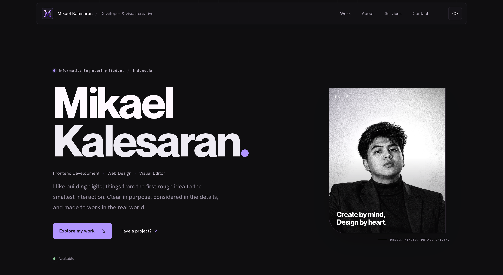

# Mikael Kalesaran

**Frontend development · Web Design · Visual Editor**

A personal portfolio for selected projects, thoughtful interfaces, and the work behind them.

[**Open the portfolio →**](https://mikaelkalesaran.com)

---

## Selected work

### KELASIN : An Academic Workspace
A local-first student planner for recurring classes, assignments, lecturers, holidays, and calendar activity.

[Open KELASIN](https://kelasin.app) · [Source code](https://github.com/biasedfilms/kelasin)

### Velora : Your Personal Finance
A privacy-first budgeting workspace for income, expenses, recurring costs, and savings goals, designed to keep financial data in the browser.

[Open Velora](https://velora-mikael.vercel.app/) · [Source code](https://github.com/biasedfilms/velora)

### XANDRO : A Personal Dashboard
A personal productivity dashboard for tasks, notes, goals, weather, and daily focus.

[Open XANDRO](https://mikaelkalesaran.com/xandro/) · [Source code](https://github.com/biasedfilms/mikael-kalesaran/tree/main/xandro)

---

## Built with

- HTML
- CSS, including responsive layouts and image-based project previews
- Vanilla JavaScript for theme persistence, section-aware navigation, multi-style reveal animations, pointer-driven depth, and reading progress

---

© 2026 Mikael Kalesaran · [mikaelkalesaran.com](https://mikaelkalesaran.com)